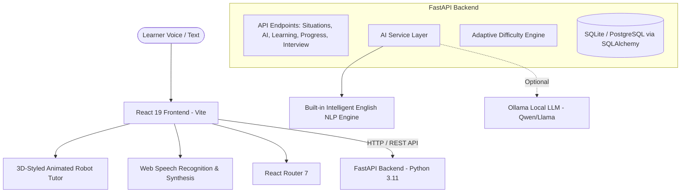

# SpeakMate AI – Architecture Documentation

## 1. System Overview

**SpeakMate AI** is an AI-powered English learning application engineered specifically for native Telugu speakers. Unlike generic chatbots, SpeakMate acts as an empathetic personal English tutor utilizing a real-life situation-based pedagogy:
1. **Explain the situation in Telugu (in Telugu script).**
2. **Ask the learner to explain or respond in English without exposing the answer beforehand.**
3. **Capture voice responses via Web Speech Recognition (with editable text fallback).**
4. **Analyze English grammar, tense, subject-verb agreement, articles, prepositions, and natural phrasing.**
5. **Present structured feedback (Sections A to G).**
6. **Evaluate learner repetition of corrected sentences for memory reinforcement.**
7. **Adapt difficulty automatically based on multi-session progress.**

---

## 2. Component Architecture

---

## 3. Database Schema (14 Tables)

1. `users`: Authentication, username, email, password hash, timestamps.
2. `learning_profiles`: Current level (BEGINNER, INTERMEDIATE, ADVANCED), daily goal minutes, streak count, total points.
3. `lessons`: Grammar and conversation topics with definition, explanation, key rules, and common mistakes.
4. `situations`: Real-life scenarios with Telugu explanations, transliterations, and English speaking prompts.
5. `exercises`: Interactive questions and practice prompts.
6. `conversations`: Free-form conversation sessions with robot tutor.
7. `conversation_messages`: Dialogue turns with coaching tips and suggestions.
8. `mistakes`: Persistent journal of mistakes (category, incorrect, corrected, explanation, repetition count, resolved status).
9. `progress`: Daily metrics (speaking minutes, situations completed, accuracy scores).
10. `assessments`: Diagnostic tests and level determinations.
11. `learning_sessions`: Practice session tracking.
12. `sentence_patterns`: Reusable structural formulas (`I want to + verb`, `I have to + verb`, etc.).
13. `vocabulary`: Essential words with Telugu meanings, English definitions, and usage notes.
14. `practice_attempts`: Detailed logs of each learner attempt, scores, and repetition evaluations.

---

## 4. Robot Tutor State Machine

The robot tutor features 7 distinct states:
- `IDLE`: Gentle floating, blinking eyes, waiting for user interaction.
- `GREETING`: Friendly welcome message and posture.
- `EXPLAINING`: Introducing the speaking scenario in Telugu.
- `LISTENING`: Real-time audio waveform animation while user speaks.
- `THINKING`: Concentric scanning / gears while evaluating learner response.
- `TEACHING`: Explaining corrections with synchronized speech waveform mouth.
- `SUCCESS`: Celebratory happy expression and confetti celebration.
